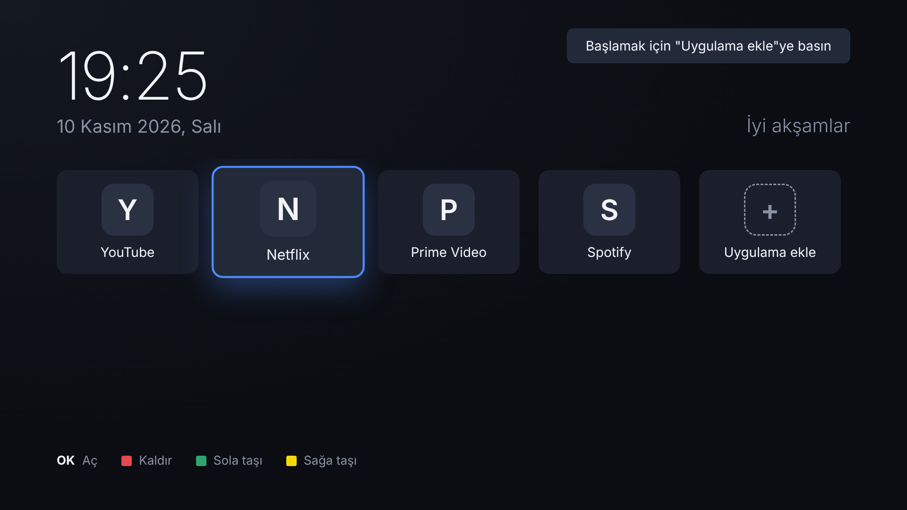

# MiniHome — Samsung TV için reklamsız minimal ana ekran

Samsung (Tizen) TV'ler için reklam, öneri veya banner içermeyen sade bir başlatıcı:



büyük saat + tarih ve yalnızca sizin seçtiğiniz uygulamaların kutucukları.

## Özellikler
- Reklam yok, internet bağlantısı yok, takip yok — tamamen yerel.
- TV'de yüklü uygulamaları otomatik listeler; istediklerinizi favori olarak eklersiniz.
- Kumanda ile tam kontrol:
  | Tuş | İşlev |
  |---|---|
  | Yön tuşları | Gezinme |
  | OK | Uygulamayı aç / (ekleme ekranında) seç-kaldır |
  | 🔴 Kırmızı | Seçili kutucuğu ana ekrandan kaldır |
  | 🟢 Yeşil / 🟡 Sarı | Kutucuğu sola / sağa taşı |
  | Geri | Ekleme ekranından çık / uygulamayı arka plana al |
- Sıralama TV'nin hafızasında (localStorage) saklanır.

## Bilgisayarda deneme
`index.html` dosyasını tarayıcıda açın. Tizen olmadığı için demo uygulama listesi gösterilir.
Klavye: yön tuşları, Enter, Esc (geri), R / G / Y (renkli tuşlar).

## TV'ye kurulum
1. **Tizen Studio**'yu kurun (TV Extensions + Samsung Certificate Extension ile):
   https://developer.samsung.com/smarttv/develop/getting-started/setting-up-sdk/installing-tv-sdk.html
2. **TV'de Geliştirici Modu**: *Apps* ekranını açın, kumandada sırayla `1 2 3 4 5` tuşlayın,
   *Developer mode*'u **On** yapın, *Host PC IP* alanına bilgisayarınızın IP'sini yazın, TV'yi yeniden başlatın.
   (Bilgisayar ve TV aynı ağda olmalı.)
3. Tizen Studio → *Tools → Certificate Manager*: **Samsung** tipi bir sertifika profili oluşturun
   (Samsung hesabınızla giriş yapılır; TV'nin DUID'si otomatik eklenir).
4. *Device Manager* → *Remote Device Manager* → TV'nin IP'sini ekleyip bağlanın.
5. *File → Import → Tizen → Tizen Project* ile bu klasörü içe aktarın,
   projeye sağ tıklayın → **Run As → Tizen Web Application**.

Komut satırı ile alternatif:
```bash
sdb connect <TV_IP>
tizen package -t wgt -s <sertifika_profili> -- .
tizen install -n MiniHome.wgt -t <cihaz_adi>
```

## Açılışta ilk sırada görünmesi
Samsung, üçüncü parti uygulamaların sistem ana ekranının (Smart Hub) **yerine geçmesine izin vermez**.
En yakın çözüm: Smart Hub'da MiniHome'un üzerine gelip **aşağı → Taşı** ile en başa almak.
TV açılınca tek tuşla MiniHome'a geçersiniz. Bazı modellerde
*Ayarlar → Genel → Başlangıç Ayarı / Autorun Smart Hub* bölümünden son kullanılan uygulamanın
açılışta açılması sağlanabilir.

## Notlar
- Geliştirici modu ile kurulan uygulamalar sertifika süresi dolana kadar çalışır; sonra yeniden yükleyin.
- Yüklü uygulamanın simgesi bulunamazsa ilk harfi gösterilir.
